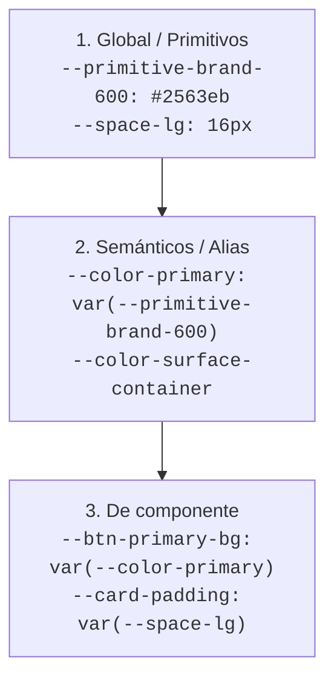

# Design Systems & Tokens: M3 + Fluent 2 + Apple HIG

Síntesis de los tres sistemas líderes — **Material Design 3**, **Fluent 2** y **Human Interface Guidelines** — en una arquitectura de tokens única y escalable.

> Los valores concretos viven en la plantilla **`design-tokens.css`** de la skill **`frontend-dls`** (carpeta `examples/`), que es la fuente de verdad de los valores. Este documento explica el *porqué* de cada capa y las decisiones de diseño; si un número difiere entre ambos, gana el CSS.
>
> Última verificación: 2026-11-04 (breakpoints de Material 3 contra m3.material.io). Los demás valores de esta guía son recomendaciones de criterio, no datos volátiles: contrastalos con la documentación de cada sistema antes de adoptarlos como número exacto.

---

## 1. Arquitectura de tokens en 3 niveles



**Por qué tres capas y no una.** El nivel primitivo responde "¿qué azul es?"; el semántico responde "¿para qué sirve este azul?". Esa separación es lo que hace que cambiar a modo oscuro sea redefinir ~20 variables semánticas en vez de auditar cada componente. Sin ella, el modo oscuro es una refactorización completa cada vez.

**Reglas de uso:**
- En componentes usá **solo** tokens semánticos o de componente.
- **Nunca** uses un primitivo directamente en un componente. `background: var(--primitive-brand-600)` funciona hoy y rompe el día que cambie la marca o entre el modo oscuro.
- Creá un token de componente solo cuando el valor necesite variar independientemente del semántico. Si `--btn-radius` siempre va a ser `--radius-md`, no lo crees; agregás indirección sin ganancia.

---

## 2. Roles de color semánticos (M3 + Apple HIG)

M3 y HIG coinciden en algo clave: cada color de fondo necesita un color de contenido explícito que garantice contraste. De ahí el prefijo `on-`.

| Rol | Propósito | Color de contenido |
| :--- | :--- | :--- |
| `primary` | Acción principal, estado activo/seleccionado. | `on-primary` |
| `primary-container` | Énfasis medio: chips activos, cards seleccionadas. | `on-primary-container` |
| `secondary` | Soporte, filtros menos destacados. | `on-secondary` |
| `surface` | Fondo base de la vista. | `on-surface` (texto principal) |
| `surface-container-low/high/highest` | Profundidad por tono, sin sombras duras. | `on-surface` |
| `surface-variant` | Fondos de inputs, sidebars, celdas. | `on-surface-variant` (texto secundario) |
| `outline` | Bordes de inputs y tarjetas. | — |
| `outline-variant` | Divisores sutiles, bordes inactivos. | — |
| `error` / `error-container` | Validación fallida, acciones destructivas. | `on-error` / `on-error-container` |
| `success` / `warning` / `info` | Estados y badges semánticos. | `on-*` correspondiente |

**El par `on-` no es opcional.** El error clásico es definir `--color-primary` y asumir que el texto encima va blanco. Cuando la marca cambia a un amarillo, el blanco encima da 1.8:1 y el botón queda ilegible. Definí el par y verificá el contraste una vez, en el token.

---

## 3. Superficies tonales y elevación

El diseño moderno prefiere **superficies tonales + sombras suaves** antes que sombras negras duras (`0 10px 20px rgba(0,0,0,0.5)`), que se ven artificiales y no funcionan en modo oscuro.

Escala de intención (valores en `design-tokens.css`, skill `frontend-dls`):

| Nivel | Uso | Superficie asociada |
| :--- | :--- | :--- |
| `0` | Base plana, contenido de página. | `surface` |
| `1` | Cards en reposo, app bar. | `surface-container-low` |
| `2` | Cards en hover, dropdowns, menús. | `surface-container` |
| `3` | Modales, dialogs, drawers. | `surface-container-high` |
| `4` | Toasts flotantes, popovers críticos. | `surface-container-highest` |

**La elevación comunica jerarquía, no decoración.** Un modal está por encima de un menú, que está por encima de una card. Si todo tiene `elevation-3`, la sombra dejó de significar algo y solo agrega ruido visual (y coste de pintado).

**En modo oscuro las sombras casi no se ven** — el negro sobre negro no contrasta. Por eso M3 usa el tono de la superficie como señal principal de elevación en dark, subiendo la luminosidad a medida que sube el nivel, y deja la sombra como refuerzo secundario.

---

## 4. Escala tipográfica

Basada en la jerarquía de M3 y en Dynamic Type de Apple.

| Rol | Tamaño | Line-height | Peso | Uso |
| :--- | :--- | :--- | :--- | :--- |
| `display-large` | `3.5rem` (56px) | 1.15 | 700 | Hero marketing, números destacados |
| `headline-large` | `2rem` (32px) | 1.25 | 700 | Título de página (`<h1>`) |
| `headline-medium` | `1.75rem` (28px) | 1.3 | 600 | Título de sección (`<h2>`) |
| `title-large` | `1.375rem` (22px) | 1.35 | 600 | Título de card o modal (`<h3>`) |
| `title-medium` | `1.125rem` (18px) | 1.4 | 500 | Subtítulos, cabeceras de tabla |
| `body-large` | `1rem` (16px) | 1.5 | 400 | Texto de lectura principal |
| `body-medium` | `0.875rem` (14px) | 1.45 | 400 | Texto de apoyo, tablas densas |
| `label-large` | `0.875rem` (14px) | 1.2 | 500 | Botones, tabs, chips |
| `label-small` | `0.75rem` (12px) | 1.2 | 500 | Badges, timestamps |

**Reglas que no están en la tabla:**
- **16px es el piso del texto de lectura.** Por debajo, en móvil, Safari hace zoom automático al enfocar un input — y ese zoom es una experiencia rota.
- **Line-length de 45-75 caracteres.** Un párrafo de 140 caracteres de ancho hace que el ojo pierda la línea al volver. Controlalo con `max-inline-size: 65ch`.
- **Line-height inverso al tamaño**: los títulos grandes necesitan menos (1.15-1.25), el cuerpo más (1.5-1.6).
- **Nunca desactives el zoom.** `user-scalable=no` o `maximum-scale=1` en el viewport incumple WCAG 1.4.4.

---

## 5. Escala de espaciado y forma

**Espaciado sobre grilla de 4px.** No es superstición: los 4px hacen que todo alinee entre sí, permiten mitades limpias, y coinciden con la grilla base de Material, Fluent y iOS. Un `13px` suelto rompe la alineación con todo lo demás y nadie recuerda después por qué era 13.

**Radios de borde** (`--radius-xs` a `--radius-full`): la regla es que el radio crece con el tamaño del contenedor. Un badge con el mismo radio que un modal se ve desproporcionado. Y para elementos anidados, el radio interno debería ser `radio externo − padding` para que las curvas queden concéntricas.

---

## 6. Layout y breakpoints

M3 define clases de tamaño en vez de una lista de dispositivos, porque los dispositivos cambian y las clases no. Material 3 hoy documenta **cinco** breakpoints (verificado en m3.material.io; las guías de Android todavía los llaman *window size classes*):

| Clase | Ancho | Layout típico | Navegación |
| :--- | :--- | :--- | :--- |
| **Compact** | < 600dp | 1 columna, márgenes 16px | Bottom bar / drawer modal |
| **Medium** | 600-839dp | 2 columnas, márgenes 24px | Navigation rail |
| **Expanded** | 840-1199dp | 3+ columnas, márgenes 24px+ | Rail o drawer permanente |
| **Large** | 1200-1599dp | Más columnas o paneles | Drawer permanente |
| **Extra-large** | ≥ 1600dp | Paneles múltiples, ancho máximo de lectura | Drawer permanente |

Las columnas "Layout típico" y "Navegación" son una síntesis orientativa, no una cita literal de M3: confirmá los detalles en el sitio antes de fijarlos como regla.

**Preferí container queries a media queries para componentes.** Una media query pregunta por el viewport, que es la pregunta equivocada: la misma card se ve distinta en un sidebar de 320px que en un main de 900px, y el viewport es idéntico en los dos casos. Reservá las media queries para el layout de página. El cookbook de `@container` está en la skill `frontend-dls` (referencia de CSS moderno y semántica).

---

## 7. Motion & easing

Duraciones y curvas en `design-tokens.css` (skill `frontend-dls`). La lógica detrás:

- **Corta (~150ms)** para feedback local: hover, active, cambio de estado de un control.
- **Media (~250ms)** para elementos que aparecen o desaparecen: dropdowns, tooltips, dialogs.
- **Larga (~400ms)** para transiciones de página o expansión de acordeones — el techo lo pone el umbral de Doherty.
- **Decelerate** para lo que entra en pantalla (arranca rápido, frena suave: se lee como llegar).
- **Accelerate** para lo que sale (arranca suave, se va rápido: se lee como irse).
- **Standard** para todo lo que se mueve dentro de la pantalla.

### `prefers-reduced-motion`, el patrón correcto

```css
@media (prefers-reduced-motion: reduce) {
  *, *::before, *::after {
    animation-duration: 0.01ms !important;
    animation-iteration-count: 1 !important;
    transition-duration: 0.01ms !important;
    scroll-behavior: auto !important;
  }
}
```

**Por qué `0.01ms` y no `none`.** Con `animation: none`, el evento `animationend` nunca se dispara — y buena parte de la lógica de cierre de toasts, modales y drawers escucha ese evento para desmontar el elemento. Con `none`, esos elementos quedan colgados en el DOM para siempre justo en el navegador de quien pidió menos movimiento. Con `0.01ms` la animación ocurre, termina de inmediato, el evento se dispara y nadie percibe movimiento.

Un matiz: la preferencia se llama *reduced*, no *no* motion. Un fade de opacidad suele estar bien; lo que hay que eliminar son movimientos amplios, parallax, zoom y rotaciones, que son los que disparan mareo vestibular.

---

## 8. Densidad de información (Fluent 2)

Fluent introduce modos de densidad porque una app de productividad (tablas, paneles de administración) y una app de consumo táctil tienen necesidades opuestas: una quiere ver más filas, la otra quiere targets grandes.

```css
:root {                          /* Estándar / táctil */
  --control-height: 40px;
  --table-cell-padding-block: 12px;
  --table-cell-padding-inline: 16px;
}

[data-density="compact"] {       /* Data-heavy */
  --control-height: 32px;
  --table-cell-padding-block: 6px;
  --table-cell-padding-inline: 10px;
}
```

Ojo: el modo compacto reduce la altura visual pero **no debe reducir el área efectiva de clic por debajo de los mínimos de accesibilidad**. Si el control mide 32px de alto, expandí el área táctil con padding transparente o pseudo-elemento.

---

## 9. Convenciones por plataforma

Si el producto corre en más de una plataforma, respetá lo nativo — es Jakob's Law aplicada al sistema operativo.

| | iOS (HIG) | Android (M3) | Web |
| :--- | :--- | :--- | :--- |
| Navegación principal | Tab bar inferior | Bottom nav / navigation rail | Header horizontal o sidebar |
| Volver | Swipe desde el borde + botón en el nav bar | Botón/gesto de sistema | Botón atrás del navegador |
| Acción principal flotante | Evitar; va en toolbar | FAB | Sin convención fuerte |
| Confirmación destructiva | Action sheet desde abajo | Dialog centrado | Modal centrado |
| Safe areas | `env(safe-area-inset-*)` obligatorio (notch, home indicator) | Insets de sistema | Solo en PWA standalone |

**Los tres principios de Apple** valen como criterio general aunque no estés en iOS: **claridad** (el contenido manda, la decoración se subordina), **deferencia** (la UI no compite con el contenido) y **profundidad** (las capas y el movimiento comunican jerarquía, no adornan).

---

## 10. Checklist de auditoría de un design system

Auditar un sistema es medir **cuánto se respeta y dónde se rompe**. El resultado se expresa en **conteos observables**, no en un puntaje: "7/10" no dice qué arreglar; "23 colores crudos en 9 archivos" sí. Un puntaje además invita a optimizar el número y no el sistema.

### Naming
- ¿Un concepto tiene **un solo nombre** en todos los componentes (no `Modal`, `Dialog` y `Popup` para lo mismo)?
- ¿Las props siguen la convención `variant` / `size` y no `kind` / `scale`?
- ¿Los tokens se nombran por **rol** y no por apariencia (ver el error más común en la sección 11)?
- **Se cuenta:** conceptos con más de un nombre.

### Cobertura de tokens
- ¿Cuántos valores crudos quedan fuera de los archivos de tokens: colores literales, espaciados que no caen en la grilla de 4px, duraciones, tamaños de fuente, radios?
- Parte de esto se mide con el auditor de la skill `frontend-dls`: `audit-frontend.js --only=tokens` reporta **colores crudos y espaciado fuera de la grilla de 4px** en archivos de estilo. Duraciones, tamaños tipográficos y radios no los cubre: se cuentan aparte, con una búsqueda de texto.
- ¿Cada color de fondo tiene su par `on-` con contraste verificado (sección 2)? ¿Hay estados disabled hechos con `opacity` sobre un color de marca (sección 11)?
- **Se cuenta:** valores crudos por tipo y por archivo.

### Completitud por componente
Para cada componente, cuatro puntos:
1. **Variantes** que el uso real pide (no las que se imaginaron).
2. **Matriz de estados** resuelta (los ocho estados definidos en la skill `frontend-dls`, referencia de componentes).
3. **Documentación de uso:** cuándo sí y cuándo no.
4. **Nota de accesibilidad:** rol, teclado, nombre accesible, anuncios.
- **Se cuenta:** componentes con los cuatro puntos resueltos sobre el total.

### Gobierno
- Cuando un cambio es incompatible, ¿hay **ruta de migración**: alias temporal, fecha de retiro y guía de reemplazo?
- ¿Quién decide agregar un componente nuevo y con qué pregunta previa ("¿hace falta o es una variante de uno existente?")?
- ¿Los tokens están versionados y los cambios registrados?
- **Se cuenta:** cambios incompatibles recientes que quedaron sin ruta de migración.

### Cómo reportarlo

| Dimensión | Qué se cuenta | Resultado (ejemplo) |
| :--- | :--- | :--- |
| Naming | Conceptos con más de un nombre | 3 |
| Tokens | Valores crudos fuera de tokens | 23 colores y 11 espaciados, en 9 archivos |
| Componentes | Con los cuatro puntos resueltos / total | 6 de 14 |
| Gobierno | Cambios incompatibles sin ruta de migración | 2 |

Los números de la tabla son un ejemplo de formato, no datos de ningún sistema real.

### Documentar un componente

Documentá lo que **se reutiliza**; una variante experimental que nadie más usa todavía no necesita ficha. Plantilla corta:

```markdown
## {Componente}

**Cuándo usarlo / cuándo no:** …
**Variantes:** variant: primary | secondary | ghost | destructive · size: sm | md | lg
**Props:** nombre · tipo · valor por defecto · qué hace
**Estados:** los ocho (default, hover, focus-visible, active, disabled, loading, error, empty); marcá cuáles aplican y cómo se ven
**Hacer / No hacer:** dos o tres pares breves, con el porqué
**Accesibilidad:** rol, teclado, nombre accesible, anuncios
**Relacionados:** componentes parecidos y cuándo elegir cada uno
```

---

## 11. Errores comunes al armar un sistema de tokens

| Error | Por qué duele | Qué hacer |
| :--- | :--- | :--- |
| Nombrar por apariencia (`--color-blue`, `--color-light-gray`) | En dark mode `--color-blue` termina siendo naranja o el nombre miente. | Nombrar por rol: `--color-primary`, `--color-surface`. |
| Un token por cada valor que aparece una vez | El sistema deja de ser sistema; nadie sabe cuál usar. | Empezá con pocos tokens y agregá cuando el valor se repita 3 veces. |
| Definir dark mode solo con `@media` | El toggle manual del usuario no funciona. | Definí ambos: `@media (prefers-color-scheme: dark)` **y** `[data-theme="dark"]`. |
| Escala de espaciado con 12 pasos | Nadie elige entre `--space-13` y `--space-14`. | 7-9 pasos con nombres semánticos (`xs`…`4xl`). |
| Opacidad para estados disabled sobre color de marca | `opacity: 0.5` sobre un botón puede caer por debajo del contraste mínimo. | Token dedicado `--color-on-surface-disabled` con contraste verificado. |
